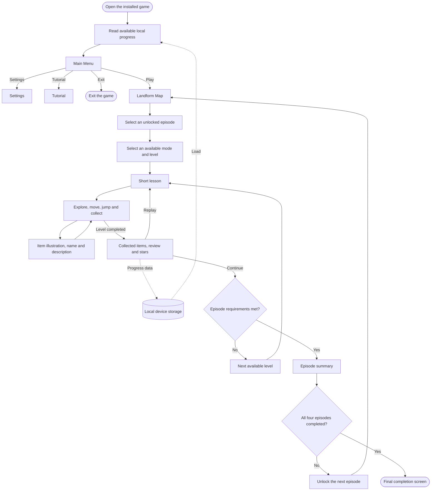

# Chapter III Technical Background

This chapter describes the proposed technical approach for Land Grand. It explains the development tools, hardware, people involved, and offline operation. It also presents how Grade 5 learners at Baluan Elementary School will use the game.

## Technicality of the project

This section explains how the proposed application will connect Science content with interactive activities. It describes the existing learning setting and the technical work needed to develop the game.

Land Grand will be an offline, single-player Android game about selected landforms, rocks, and minerals. Short lessons, exploration, item descriptions, and reviews will form its learning activities. The application will combine these activities in a two-dimensional environment with touch controls.

### Current learning and technical setting

This section describes the learning arrangements relevant to the project. It distinguishes the existing materials from the proposed digital resource.

According to the researcher's October 2026 account, Baluan Elementary School holds face-to-face classes. Printed materials and adult guidance remain part of the project's home-study context. Modular learning is described as an option if a disaster interrupts classroom instruction.

The existing parent and teacher survey includes reports of access to phones, tablets, or computers. These reports do not confirm access to Android devices that meet the game's requirements. Land Grand will therefore serve as an additional learning resource alongside printed materials and teacher guidance.

The proposed application will place its learning content and saved progress on the device. Its operation will not depend on a school server or a continuous internet connection.

### Development

This section explains how the proposed software components and learning materials will be combined. It describes the main technical tasks involved in preparing the application.

The developer will prepare lesson text, item descriptions, illustrations, and graphical assets for the selected topics. These materials will be arranged into game scenes and connected through the application's scripts. The lessons and selected examples will require scientific and curriculum review before use.

The game scenes will connect the lesson, exploration, collection, and review activities. Touch controls will support movement and jumping. Item collection will display the relevant illustration, name, and short description. The progress system will record available content and completed activities on the device.

The developer will prepare an Android build and check a complete level on the intended devices. These checks will examine the lesson display, controls, item information, results, and continuation from saved progress. Their outcomes will guide later development.

## Details of the technologies to be used

This section explains the proposed hardware, software, and peopleware for Land Grand. It also describes the network boundary of the offline application.

### Hardware

This section presents the declared development equipment and proposed learner-device targets. The development computer will support application preparation, while Android phones and tablets will run the game.

The declared development computer has the following specifications:

| Component | Declared specification |
| --- | --- |
| Processor | 11th Gen Intel Core i7-1185G7 at 3.00 GHz |
| Memory | 16 GB RAM, 2400 MHz |
| Graphics | Intel Iris Xe Graphics |
| Storage | 256 GB SSD |

The proposed minimum targets for the learner's device are:

| Component | Proposed target |
| --- | --- |
| Device | Android phone or tablet |
| Operating system | Android 10 and above |
| Memory | 2 GB RAM |
| Available storage | 300 MB free space |

The learner-device targets remain subject to testing. Actual memory use, installation size, and performance will depend on the completed build and the device used. The stated targets do not establish compatibility with every Android device.

### Software

This section describes the planned software tools and their roles in the project. It explains how the operating system, game engine, graphics tools, code editor, and build tools will support development.

#### Development Operating System

This section identifies the operating system in the declared development setup. It explains its role in running the project tools.

The proposed development environment will use Windows 11, 64-bit. The developer will use this environment to manage project files, prepare assets, edit scripts, and produce application builds. Windows is the development platform; Android is the intended platform for learners.

#### Game Engine

This section describes the planned role of Unity in Land Grand. It explains how the engine will bring the game's components together.

Unity will be used to arrange the two-dimensional scenes, interface elements, audio, and graphical assets. It will connect touch input with character actions and the collection activities. The project will also use Unity to prepare its Android build.

#### Editing Software

This section describes the tools selected for the game's visual materials. It explains their planned contributions to the graphics workflow.

Piskel will be used to prepare pixel-art sprites and frame-based animations for the game. The planned outputs include character and item images for use in Unity. This work will support the game's two-dimensional presentation.

Clip Studio Paint supports illustration and animation work (Celsys, 2025). In Land Grand, the developer plans to use it for selected illustrations and graphical assets. These materials will provide visual examples alongside the lesson text and item descriptions. The planned digital illustrations will supplement physical examples and teacher explanations.

#### Code Editor

This section explains the role of Visual Studio Code in preparing the application scripts. It describes the editing support relevant to Unity development.

Visual Studio Code will be the selected code editor for C# scripts. Microsoft's Unity guide describes code completion and debugging through the appropriate Unity and C# extensions (Microsoft, 2023). The developer will configure the editor and extensions for the project. These tools will support script preparation and debugging during development.

#### Programming Language

This section describes how C# will be used in the application. It identifies the planned game functions controlled by scripts.

C# scripts will connect the interface, character actions, item collection, and scene changes. They will also control access to available levels, prepare level results, and handle local progress data. These functions will follow the documented scope and the game rules established during design.

#### Android Build Tools and Installation Package

This section explains the tools needed to prepare an Android application package. It distinguishes application installation from the game's planned offline operation.

Unity's Android documentation identifies Android Build Support, the Android Software Development Kit, the Native Development Kit, and a Java Development Kit as build dependencies. Unity uses OpenJDK by default (Unity Technologies, 2026). The development setup will use dependency versions compatible with the selected Unity editor.

An Android Package, or APK, contains application components needed for installation and use on Android devices (Google, 2025). The proposed Land Grand build will be prepared as an installable APK. After installation, its planned lessons, graphical assets, audio, and progress functions will be available on the device. Offline operation will depend on including these resources locally and avoiding online service dependencies.

### Peopleware

This section describes the people involved in developing and using Land Grand. It distinguishes development responsibilities from the support provided during learning.

The developer and researcher will prepare the application, organize its learning materials, and carry out the planned technical checks. Science content will require review for accuracy and suitability for Grade 5 learners. Content review is planned work rather than completed validation.

Grade 5 learners at Baluan Elementary School will be the intended players. They will use the application as an additional resource for the selected Science topics. The proposed interface will use large touch buttons for the main character actions.

Teachers may guide learners and provide feedback on the proposed Science materials. Parents or guardians may assist with home study and device use. These supporting roles do not require online accounts or access to centralized learner records. Participation in a formal evaluation will depend on the study's documented arrangements.

### Network and Offline Operation

This section explains the application's planned network requirements and local data handling. It describes the boundaries of offline use.

Land Grand will be designed for gameplay without an internet connection after installation. Lessons, item illustrations, audio, and progress data will be kept on the device. The project will not include multiplayer, online accounts, cloud storage, a website, or an administrator panel.

Saved progress will remain on the device used for play. The proposed application will not provide central teacher monitoring or shared learner records. Obtaining and installing the application package is separate from playing the installed game.

## How the project will work

This section explains the proposed sequence of using Land Grand. It describes the menu choices, learning activities, progression, and local progress handling.

The learner will open the installed application on an Android device. The game will load available saved progress for the play session. The Main Menu will offer Play, Settings, Tutorial, and Exit. Selecting Play will open the Landform Map.

The following figure presents the proposed gameplay flow. Solid arrows show the main screen and activity paths. Dashed arrows show the relationship between gameplay and local progress data.

*Proposed Gameplay and Local Progress Flow of Land Grand*

The Landform Map will contain four episodes covering Mountains, Hills, Plains, and Plateaus. Only unlocked episodes will be available for selection. Each episode will have 3 Easy, 5 Normal, and 7 Hard levels, for a planned total of 60 levels. Progression will move from Easy to Normal and then Hard as the required content is completed.

A short lesson will appear before each level. It will introduce the selected landform and related rock or mineral content. The learner will then control an explorer character through the two-dimensional environment. Movement, jumping, and item collection will form the main actions. Challenges will include obstacles, traps, pitfalls, and time limits.

When an item is collected, the game will show its illustration, name, and short description. The learner can then continue exploring. These digital examples will provide information during the activity. They will not provide physical specimens or hands-on examination of real rocks and minerals.

After a completed level, the Result Screen will present the collected items, a short review, and up to three gameplay stars. The learner may replay the level or continue to available content. The game will display an episode summary when the episode's required levels are completed. It will then unlock the next episode when applicable.

After all four episodes are completed, the final screen will present the total stars, collected items, and a completion message. Stars and completed levels will describe gameplay progress. They will not, by themselves, measure gains in Science knowledge.

The game will automatically save the player's name, unlocked episodes, completed levels, stars, and collected items on the device. It will load available progress in a later play session so the learner can continue. This local record will support continued use of the game without an online account.
