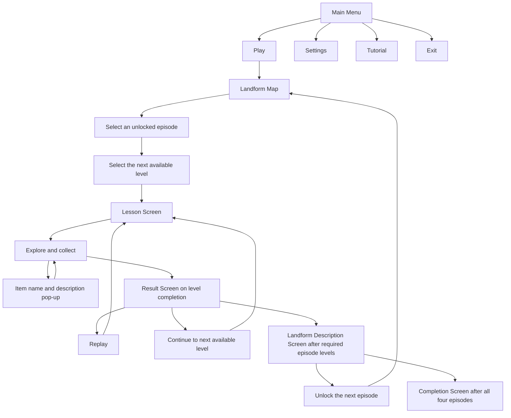

# Game Flow

This diagram summarizes [[Project/Scope and Requirements|LG-06 through LG-17]]. It describes the proposed flow; it is not a record of implemented screens.

Source: [[Sources/Pre-proposal Extract#Program Specification|Program Specification]]. Replay passes through the pre-level lesson because the proposal places a lesson before each level.

## Progression boundaries

The proposal lists Mountains, Hills, Plains, and Plateaus. It does not explicitly confirm that this list is the required episode order, which episode starts unlocked, or what counts as completing a level or an episode. Easy → Normal → Hard is explicit. The diagram's completion branches describe conditional paths; the exact guards remain Q-02 and Q-03 in [[Questions/Open Questions|Open Questions]].

Failure, retry, pause, returning to the map, and the behavior of a time limit are unspecified. Record decisions before treating any of those paths as requirements.
