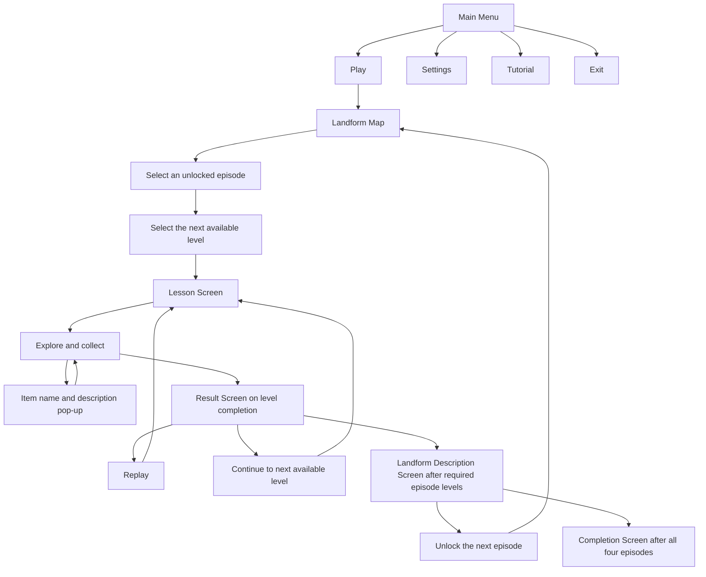

# Game Flow

This diagram summarizes [[Project/Scope and Requirements|LG-06 through LG-17]]. It describes the proposed flow; it is not a record of implemented screens. The Main Menu's contents are confirmed in [[Project/Main Menu]] (D-032); until the Landform Map exists, Play shows a "Coming soon" panel.

Source: [[Sources/Pre-proposal Extract#Program Specification|Program Specification]]. Replay passes through the pre-level lesson because the proposal places a lesson before each level.

## Final manuscript procedure (D-036)

The final Chapter III (2026-11-13) describes the game procedure in five flowcharts, Figures 4A–4E, in [[Sources/Final Manuscript Chapters I-III 2026-11-13]]. The user said these flowcharts still need to be fixed and redesigned, but they are the concept the game follows. Their rules are LG-26 to LG-32 in [[Project/Scope and Requirements#Final manuscript additions (D-036)|Scope and Requirements]].

1. **Launch and Main Menu (4A):** open the game, load saved progress if any, show the Main Menu. The built game also shows the "Tap to Start" start-up screen before the Main Menu (D-037); Figure 4A should show it after the redesign. Exit asks "Exit game?" before closing (D-038); Figure 4A should show that too. Settings and Tutorial return to the menu; Play opens the Landform Map; Exit closes the game.
2. **Episode and level selection (4B):** tap an unlocked episode, then a level in an unlocked mode.
3. **Lesson and level (4C):** lesson, then play with touch controls. Item collected leads to a pop-up and back to play; end goal leads to level complete; timeout or pit fall leads to Retry or Back to Main Menu.
4. **Score, save, unlock (4D):** stars from rock-count thresholds, automatic save, Easy then Normal then Hard unlock, Result Screen, then Replay or Continue.
5. **Continue or complete (4E):** next level, or the Landform Description Screen and the next episode, or the Completion Screen after all four.

The agreed gameplay and the redesigned five-part flowchart are in [[Project/Gameplay Design]] and [[Manuscript/Drafts/Land Grand - Chapter III - Game Procedure Flowchart - v2.drawio|draw.io version 2]] (D-044).

## Progression boundaries

The proposal lists Mountains, Hills, Plains, and Plateaus. It does not explicitly confirm that this list is the required episode order, which episode starts unlocked, or what counts as completing a level or an episode. Easy → Normal → Hard is explicit. The diagram's completion branches describe conditional paths; the exact guards remain Q-02 and Q-03 in [[Questions/Open Questions|Open Questions]].

Failure, retry, pause, returning to the map, and the behavior of a time limit are unspecified. Record decisions before treating any of those paths as requirements.
